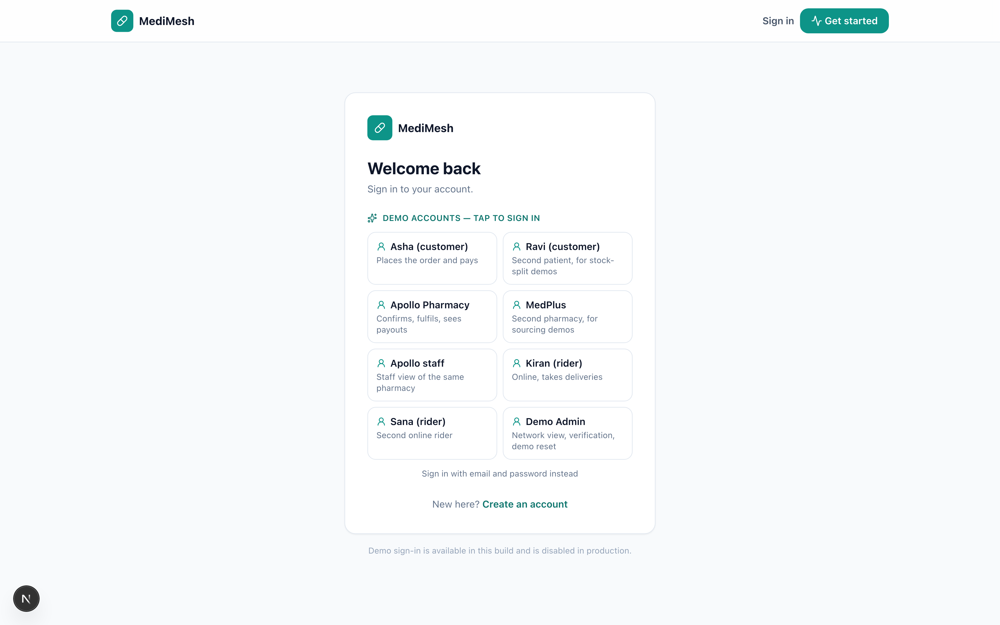
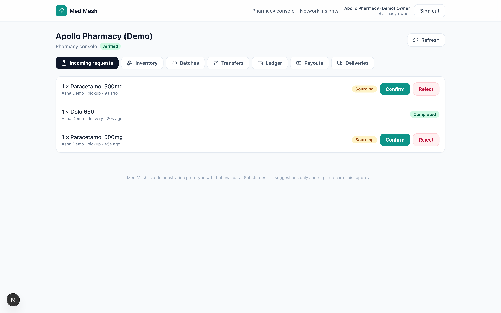
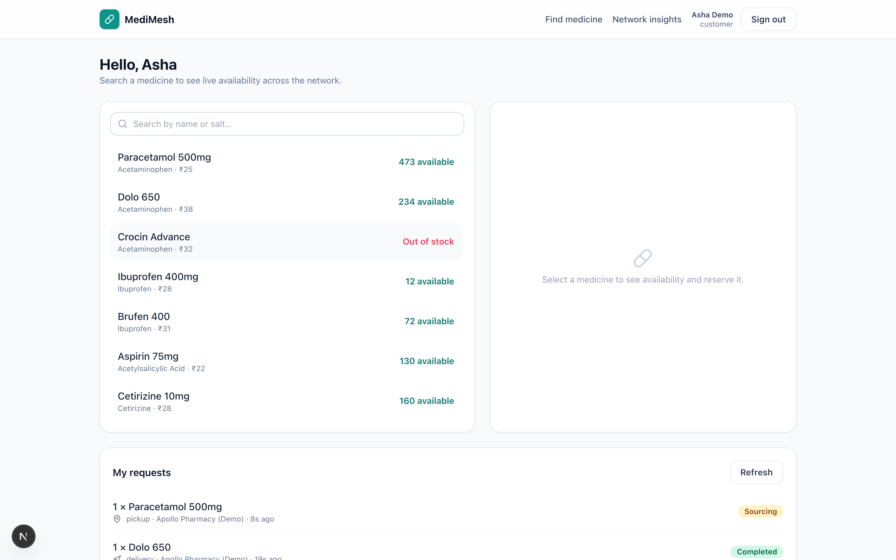
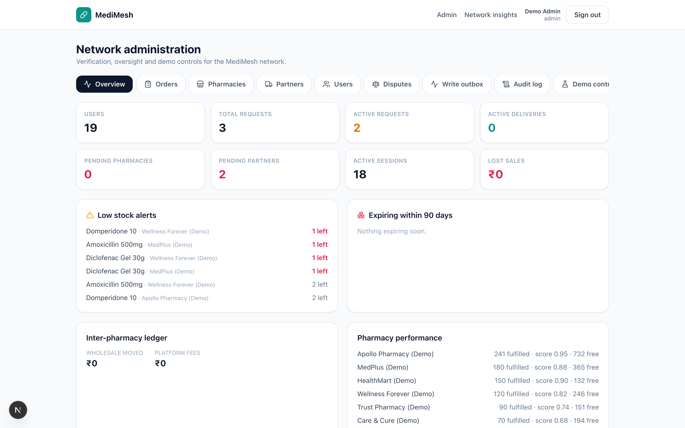
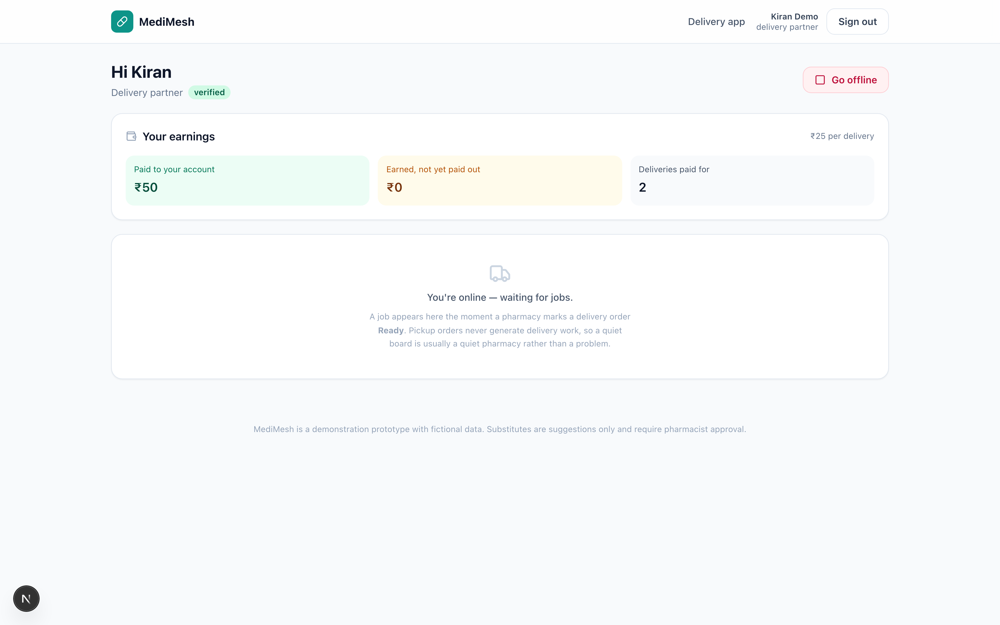
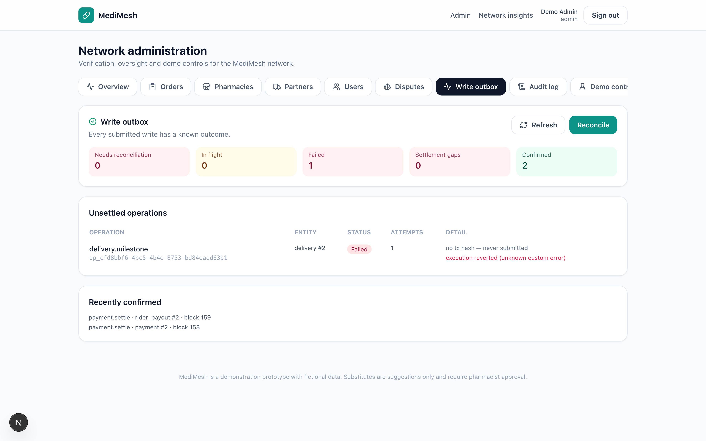

# MediMesh

**Medicine availability, reservation & delivery network.** A customer requests a medicine;
MediMesh ranks nearby verified pharmacies by distance, stock confidence, response time and
fulfilment history, soft-locks stock atomically, borrows from peer pharmacies when the preferred
one is short, and delivers it — with live rider tracking, an OTP-verified handover, a transparent
inter-pharmacy ledger and a full audit trail.

Four role-based apps (customer, pharmacy, delivery partner, admin) over a single PostgreSQL
source of truth. No external accounts, API keys or cloud — a self-contained local prototype.

An optional **blockchain audit layer** records medicine batches, inter-pharmacy transfers and
delivery milestones on a local Hardhat EVM. See [docs/blockchain.md](docs/blockchain.md).

---

## Stack

| Layer     | Choice |
|-----------|--------|
| Framework | Next.js 15 (App Router) + TypeScript (strict) |
| Styling   | Tailwind CSS 3 |
| Database  | PostgreSQL via `pg` (schema in `lib/schema.sql`, auto-applied + seeded on first run) |
| Auth      | `@node-rs/argon2` (argon2id) + server-side sessions + RFC-6238 TOTP 2FA |
| Realtime  | Server-Sent Events (SSE) over an in-process event bus |
| Maps      | Leaflet + OpenStreetMap (`react-leaflet`, client-only via `next/dynamic`) |
| Blockchain (optional) | Solidity 0.8.24 + Hardhat + ethers v6 (local chain, chainId 31337) |
| Validation| `zod` |
| Tests     | `vitest` (unit/integration) + `@playwright/test` (e2e) + Hardhat (contracts) |

---

## Quick start

```bash
npm install
npm run dev
```

Open <http://localhost:3000>. On first run the app applies `lib/schema.sql` to the PostgreSQL
database in `DATABASE_URL` (default `postgresql://localhost/medimesh`) and seeds 8 Bengaluru
pharmacies, 24 medicines and demo users for every role.

**Demo credentials** are printed to the server terminal and written to `data/.demo-credentials.txt`
(git-ignored). Passwords are random per seed run and regenerate on every **Reset**. Accounts with
2FA enabled (`admin`, `owner1`) also get a TOTP secret there — add it to an authenticator app, or
use the e2e/acceptance helpers which compute codes automatically.

> Use `npm run dev` for local demos. `npm run start` (production) intentionally **refuses to boot
> without secrets** — see [Secrets](#secrets). Dev auto-generates throwaway secrets under
> `data/.dev-secrets.json`.

### Optional: the blockchain audit layer

The app runs without it. To switch it on:

```bash
npm run chain:node        # terminal 1 — local Hardhat EVM on 127.0.0.1:8545
npm run chain:deploy      # terminal 2 — deploys the ledger, writes deployments/local.json
npm run abi:generate      # the server reads a generated ABI, not the manifest
npm run db:reset          # re-seeds and re-maps on-chain wallets to the new users
```

`npm run db:reset` maps wallets automatically. After a contract change, `abi:generate` is not
optional: the server builds its contract interface from `lib/blockchain/abi.generated.json`, so a
stale copy produces `no matching function` on exactly the call you just added — which looks like a
chain problem and is not.

---

## Screens

| | |
|---|---|
|  |  |
| One-tap demo sign-in — no password, no OTP for the demo personas | Pharmacy console: batches, stock, peers, payouts |
|  |  |
| Customer: ranked availability across nearby pharmacies | Admin: who ordered, from which pharmacy, with which rider |
|  |  |
| Rider earnings — paid, and earned-but-not-yet-paid, kept apart | Write outbox: every chain operation and its outcome |

Regenerate with `npx playwright test e2e/screenshots.spec.ts --project=desktop`. The rider screen
is captured after a real delivery is driven through the API, so the figures in it are real.

---

## Pages & apps (by role)

| Route | Role | What it does |
|-------|------|--------------|
| `/` | public | Animated landing page: live network stats + value proposition |
| `/login`, `/register`, `/pharmacy/register`, `/rider/register` | public | Sign in / customer sign-up / pharmacy & rider onboarding |
| `/app` | customer | Search a medicine, see ranked availability, reserve (pickup or delivery), track live |
| `/app/request/[id]` | customer | Request timeline, split/partial details, live delivery map, demo OTP reveal, cancel/collect |
| `/pharmacy` | pharmacy_owner / staff | Incoming requests (verify Rx / confirm / reject / ready), inventory editor, borrow ledger, active deliveries |
| `/rider` | delivery_partner | Go online, accept/decline job offers, advance the delivery state machine, run the location simulator, OTP + ID handover |
| `/admin` | admin | Overview metrics, verify pharmacies & partners, users, audit log, demo controls |
| `/insights` | staff roles | Network-wide demand, low stock, expiries, lost sales, ledger totals, pharmacy performance |

---

## Environment variables

| Variable | Purpose |
|----------|---------|
| `MM_DATA_DIR` | Override the runtime data directory (defaults to `./data`). Used by tests. |
| `DEMO_MODE` | `1`/`true` (or any non-production `NODE_ENV`) enables demo affordances: terminal SMS, demo OTP reveal, location telemetry bypass. |
| `LOCK_MINUTES` | Default reservation lock expiry in minutes (default 30). The demo toggle switches to 20 seconds. |
| `MM_QUIET` | `1` suppresses seed/credential console output. |
| `APP_ENCRYPTION_KEY` | AES-256-GCM key (hex) for encrypting TOTP secrets and ID numbers. **Required in production.** |
| `SESSION_PEPPER` | HMAC pepper for session-token hashing. **Required in production.** |
| `MM_KYC_ENDPOINT` | If set, document checks are routed to a real KYC/eKYC gateway (POST JSON) instead of the offline demo provider. |
| `MM_KYC_API_KEY` | Bearer token sent to `MM_KYC_ENDPOINT`. |
| `MM_SMS_ENDPOINT` | Optional HTTP gateway for outbound notifications (job offers, assignments, refunds). Falls back to printing in the terminal. |
| `MM_SMS_API_KEY` | Bearer token sent to `MM_SMS_ENDPOINT`. |
| `MM_RAZORPAY_KEY_ID` | Merchant key id. When both Razorpay keys are set, live Razorpay is used; otherwise a deterministic demo gateway runs. Server-only. |
| `MM_RAZORPAY_KEY_SECRET` | Merchant key secret. Never sent to the browser; also enables the local demo checkout signature helper. |
| `MM_RAZORPAY_WEBHOOK_SECRET` | Verifies `x-razorpay-signature` on `/api/webhooks/razorpay`. **Required in production** or every webhook is rejected. |
| `NEXT_PUBLIC_RAZORPAY_KEY_ID` | Publishable key id — the only payment value safe in the browser. |
| `NEXT_PUBLIC_BLOCK_EXPLORER_URL` | Optional block explorer used to link settlement receipts. |

### Secrets

No secret is hard-coded. In development, `requireSecret()` auto-generates missing secrets into
`data/.dev-secrets.json` (git-ignored). In production it throws if `APP_ENCRYPTION_KEY` or
`SESSION_PEPPER` are unset. TOTP secrets are stored AES-256-GCM-encrypted (`crypto.ts`).

---

## Data model

```
pharmacies(id, name, address, lat, lng, drug_licence_no, verification_status, response_score, fulfilment_count,
           licence_verified, licence_checked_at, licence_meta_json,
           razorpay_account_id, payout_account_status, payout_account_checked_at)
medicines(id, name, salt, price_paise, rx_required)
inventory(pharmacy_id, medicine_id, qty_total, qty_locked, expiry_date)
requests(id, customer_id, customer_name, medicine_id, qty, secured_qty, preferred_pharmacy_id,
         fulfilment_type, delivery_address, delivery_lat, delivery_lng, status, rx_verified,
         substitute_for_id, idempotency_key, amount_paise, platform_fee_paise, payment_status, created_at)
reservations(id, request_id, pharmacy_id, qty, lock_expires_at, status, kind)
payments(id, request_id, customer_id, pharmacy_id, amount_paise, platform_fee_paise,
         pharmacy_amount_paise, currency, gateway, status, razorpay_order_id, razorpay_payment_id,
         razorpay_transfer_id, beneficiary_account_id, captured_at, paid_out_at, refunded_at, settled_at)
payment_audit(id, payment_id, settlement_ref, settlement_ref_hash, order_ref, order_ref_hash,
              amount_paise, metadata_hash, metadata_json, gateway_ref_hash, beneficiary_wallet,
              status, tx_hash, block_number)
ledger(id, from_pharmacy_id, to_pharmacy_id, medicine_id, qty, wholesale_amount, platform_fee, created_at)
lost_sales(id, medicine_id, area, qty, value, created_at)
demand_events(id, medicine_id, area, qty, created_at)
deliveries(id, request_id, pharmacy_id, partner_id, status, destination_address, destination_lat,
           destination_lng, rx_required, distance_km, eta_minutes, otp_hash, otp_enc, otp_expires_at,
           otp_attempts, id_checked, proof_json, ...timestamps)
delivery_offers(id, delivery_id, partner_id, status, offered_at, expires_at)
delivery_location(id, delivery_id, partner_id, lat, lng, heading, speed_mps, recorded_at)
users(id, email, name, phone, password_hash, role, pharmacy_id, totp_secret_enc, totp_enabled,
      vehicle_number, id_type, id_last4, id_number_enc, doc_status, doc_checked_at, doc_meta_json,
      partner_online, partner_status, rating, failed_attempts, locked_until, ...)
sessions(id, token_hash, user_id, role, ip, user_agent, created_at, last_seen_at, expires_at, revoked)
recovery_codes, login_attempts, audit_log, settings
```

**Money is stored as integer paise** and formatted for display. All timestamps are UTC ISO strings.

Request lifecycle:
`Requested → Sourcing → Confirmed → Ready → (Completed | delivery states)`, with side states
`NeedsVerification` (Rx gate), `PartialOffer` (short stock), `Unavailable`, `Rejected`, `Expired`,
`Cancelled`.

Delivery state machine:
`SearchingPartner → AwaitingPharmacyApproval → Assigned → ArrivedAtPharmacy → PickedUp → OutForDelivery
→ ArrivedAtDestination → Delivered`, plus `HandoverFailed`, `CustomerUnreachable`, `ReturnedToPharmacy`,
`Cancelled`.

---

## Blockchain audit layer (optional)

Medicine batches, inter-pharmacy transfers and delivery milestones can be anchored to a **local
Hardhat EVM** (chainId 31337). The database stays the operational source of truth; the chain only
records a verifiable audit trail. Everything except the audit layer keeps working when the chain is
offline.

```bash
npm run chain:install     # once
npm run chain:node        # terminal 1 — http://127.0.0.1:8545
npm run chain:compile     # terminal 2
npm run chain:test        # 50 contract tests
npm run chain:deploy      # writes blockchain/deployments/local.json
npm run abi:generate      # refreshes lib/blockchain/abi.generated.json
npm run dev               # terminal 3
```

Then use the **Batches** and **Transfers** tabs in the pharmacy console. Batch QR codes lead to the
public verification page at `/verify/<batchRef>`.

End-to-end verification against the live local chain:

```bash
npm run smoke:blockchain  # 32 checks
npm run smoke:delivery    # 12 checks
npm run smoke:payments    # 15 checks — order → pay → payout → chain → QR → refund → outbox
npm run smoke:delivery-assign  # 14 checks — delivery job → offer → rider → approval → contact
npm run screenshots       # captures every demo screen into demo-assets/screenshots/
```

Only opaque references and hashes go on-chain — never customer names, addresses, prescriptions or
GPS traces. Full details, trust boundaries and limitations: **[docs/blockchain.md](docs/blockchain.md)**.

---

## Hardening: rate limits, refunds, outbox

**Rate limiting.** `login` (20/min per IP, 8/min per account), `2fa` (6 attempts per
challenge) and `payment/verify` (15/min) are throttled *before* any credential
comparison or gateway call, with `429` and a `Retry-After` header. A 6-digit code
is the weakest credential in the system and gets the tightest limit. This slows
guessing down; it is not the security boundary, and the code says so.

The counters live in **Postgres, not in process memory**. The deploy target is
serverless: a cold start used to hand every attacker a brand-new allowance, and two
concurrent instances could both admit a request the other had just refused. The
increment and the expired-window reset happen in one statement, because a
read-then-write races and admits both. If the database is unreachable the limiter
degrades to a process-local map rather than throwing — a weakened limiter still
slows guessing down; an outage that locks every customer out does not.

**Refunds and disputes.** A pharmacy or admin can refund a payment **while the
money is still ours to return** — captured but not yet paid out. Once the payout
has been released, the route refuses with a clear reason rather than half-
performing: reversing a settled payment is money owed in the *opposite*
direction, which needs a person and a dispute, not a button. That guard lives in
the domain function, not the route, because the refund path has more than one
caller. Refunds are idempotent, and the customer is notified.

**Disputes.** A customer can report a problem on a paid order; the pharmacy can
reply; **only an admin decides the outcome**. An upheld refund does one of two
honest things, and the UI says which: while the payment is still captured it is a
real gateway refund; once the pharmacy has been paid it records
`recoverable_paise` — an amount the pharmacy owes MediMesh, recovered offline. No
gateway call is attempted in the second case and no surface claims money moved.

**Rider approval is a human decision.** A rider is handed the customer's address,
the medicine and the handover OTP, so registration leaves `partner_status =
pending` and an admin approves from the Partners tab. This used to auto-approve on
a checksum-valid document number, which is not a person. A pending rider sees an
explanation instead of a "Go online" button the server would refuse.

**Expired stock is refused at the moment of dispense.** Availability queries hide
expired batches, but a batch can pass its date while an order sits Ready, so both
dispense paths re-check: pickup completion refuses and audits
`request.blocked_expired_stock`; delivery handover refuses *before* the OTP is
compared and tells the rider to take the box back, because they are holding it.
Without those checks the earlier filtering was theatre.

**Write outbox (admin).** Every blockchain write is persisted before submission,
so a crash leaves a row rather than a mystery. That guarantee is invisible unless
somebody can see the queue, so the admin console has a **Write outbox** tab:
unresolved count, in-flight, failed, settlement gaps, confirmed, plus a
**Reconcile** action that reads the chain for what actually happened and never
re-submits. When the RPC is down it says so instead of showing a false clean
bill of health.

**Notifications.** Rides and payments are no longer silent. A rider is told when
a job is offered, and both rider and customer are told when the pharmacy approves
the assignment. Notifications go through a swappable provider (console by
default, an HTTP gateway via `MM_SMS_ENDPOINT`) and are deliberately
best-effort — a notification failure never rolls back or blocks the operation it
was describing, which is exactly why it is separate from the OTP channel.

**Receipt QR.** Every settled payment gets a QR that encodes the *public
verification URL* and nothing else, so a customer can carry it away and a
stranger can scan it. It appears only once there is something on-chain to point
at.

---

## Operator view & customer↔rider contact

**Admin → Orders tab.** Every order on one row with all three parties joined:
who ordered it, which pharmacy is fulfilling it, which rider has it, and how
much was routed to the pharmacy. The list updates live over SSE, because during
an incident the operator should not be guessing whether to press refresh.

Customer contact details are deliberately **not** in that table. An operator needs
to resolve an order, not browse the patient list.

**Customer → "Your rider".** On a delivery order the customer can see and reach
the rider carrying it — **Call** (`tel:`) and **Text** (`sms:` with a prefilled
body), which hand off to the phone's own dialer and messaging app.

The rider's number starts masked (`XXXXXX0001`). It is released only when the
customer taps "Show number", only to the customer who placed that order (or the
fulfilling pharmacy / an admin), only once a rider is actually assigned, and
**every disclosure is written to the audit log** as `contact.phone_revealed`. A
`tel:` link the customer cannot see until they ask is the point; a page that
preloads every rider's number is not a feature.

---

## Demo mode: one-tap sign-in

Every seeded demo user has 2FA enabled, which makes a live walkthrough painful — the operator has to
read a TOTP code off another screen while a judge watches. In a non-production build the **login
page lists the demo personas as buttons**: Asha (customer), Apollo Pharmacy (owner), Kiran (rider),
Demo Admin, and a few more. One tap signs you in, password and second factor included.

Three things keep this from being a hole:

1. `NODE_ENV=production` wins over every env var — `DEMO_MODE=1` cannot switch demo mode on in a
   deployed environment, and the route returns 404 there.
2. Only `@medimesh.demo` accounts are eligible, so a genuinely registered user can never be
   impersonated, even in demo mode.
3. Every bypass is written to the audit log as `auth.demo_login`, so the security log does not
   quietly become fiction.

If the database has not been seeded yet, the buttons simply do not appear rather than failing on
click.

```bash
npm run db:migrate      # apply schema changes without restarting the dev server
npm run smoke:payments  # walk the whole demo flow end to end against a running server
```

`smoke:payments` exercises the exact path a judge sees: one-tap sign-in as the customer, order,
one-tap sign-in as the owner, link payout account, confirm, pay, fulfil, then read the payout and the
on-chain settlement receipt back. Ten checks.

> Schema note: a column added after a table first shipped must be declared with
> `ALTER TABLE ... ADD COLUMN IF NOT EXISTS`, not inline in the `CREATE TABLE`. `CREATE TABLE IF NOT
> EXISTS` is a no-op on an existing table, so an inline addition never reaches a deployed database —
> and the failure only shows up at runtime, mid-demo.

---

## Payments & settlements

Customers pay through **Razorpay** and the pharmacy owner is credited **directly to their own linked
account** at capture time — only the platform fee (5%) is retained. Funds never rest in a MediMesh
balance. Bank details are entered on Razorpay's hosted onboarding page and are never stored here.

```bash
# Optional: without these the app runs a deterministic demo gateway,
# so order -> pay -> settle -> on-chain-record works offline.
MM_RAZORPAY_KEY_ID=rzp_live_...
MM_RAZORPAY_KEY_SECRET=...
MM_RAZORPAY_WEBHOOK_SECRET=...      # required in production
NEXT_PUBLIC_RAZORPAY_KEY_ID=rzp_live_...
```

Flow:

1. The pharmacy **confirms** an order → the total is frozen server-side from the catalogue price and a
   payment intent opens.
2. The customer pays. Checkout is verified server-side (HMAC over `order_id|payment_id`, compared in
   constant time) before anything is captured — a forged callback cannot create a charge.
3. Capture routes the pharmacy owner's share to their linked account.
4. When the order is **fulfilled** (pickup collected, or delivery handed over with OTP + geofence), the
   payment is marked `PaidOut` and the settlement is anchored on-chain.

### Who gets what

| | Pickup | Delivery |
|---|---|---|
| Order total | medicine price | medicine price **+ ₹25 delivery fee** |
| Pharmacy owner | medicine − 5% platform fee | medicine − 5% platform fee |
| Rider | — | the full delivery fee |
| MediMesh | 5% of the medicine | 5% of the medicine |

The platform fee is charged on the **medicine amount only**. Taking a cut of the delivery fee would be
money taken out of the rider's pay for a service MediMesh did not provide, and at these amounts it
would leave the rider with roughly one rupee.

**When the rider is paid, stated precisely because it is easy to overstate.** The customer pays before
a rider has been assigned, so at capture there is no account to transfer the fee to. It is transferred
after the verified handover, straight to the rider's own linked account. Between capture and handover
the fee rests in the platform balance — owed to the rider the whole time and never MediMesh revenue,
but not yet in the rider's bank account. The rider's earnings panel therefore shows **two** figures,
"paid to your account" and "earned, not yet paid out", rather than one combined number that would
promise money that has not moved.

Anchoring is append-only: a settlement reference can be recorded once, the beneficiary must hold
`PHARMACY_ROLE`, and the receipt reads back the same metadata hash it was written with.

The rider's fee is anchored separately, through `recordRiderSettlement`, keyed and replay-guarded
independently of the pharmacy's anchor. Two anchors rather than one record with two amounts is
deliberate: neither party's amount can then be invalidated by a dispute about the other, and each has
its own beneficiary role check (`DELIVERY_ROLE` for the rider).

> **Scope of the anchor.** It proves an authorized pharmacy wallet *reported* the settlement and that
> the record has not changed. It is not a bank statement — the gateway is the evidence of money. A
> chain outage never blocks a delivery; it only defers the anchor, which the reconcile job picks up.

> **Refunds after payout.** A refund is only possible while the payment is still captured. Once a
> pharmacy has been paid, returning the money means recovering it from them, so
> `/api/requests/[id]/refund` says so and points at the dispute flow, which records the amount as an
> obligation instead of pretending a refund happened.

### Public settlement verification

Every payout gets an opaque reference (`SET-XXXX-XXXX-XXXX-XXXXXXXX`) and a **public, unauthenticated**
verification page:

```
/verify/settlement/SET-XXXX-XXXX-XXXX-XXXXXXXX
```

Anyone can open it — a customer, a regulator, or someone on their own phone — with no account. The page
runs three independent checks rather than restating our database:

1. the reference hashes to a settlement that exists on-chain;
2. the on-chain metadata hash equals a hash **recomputed in the browser request** from the stored
   canonical metadata — so "record unaltered" is proven, not claimed;
3. the on-chain amount and beneficiary are what gets displayed, so editing a local row cannot change
   what the page reports.

If the chain record disagrees with the stored metadata, the page says **Disputed — do not rely on this**
and tells the viewer to escalate rather than pay out. If the reference is unknown, it says exactly that,
and explicitly notes this is *not* evidence that a pharmacy withheld a payment. If the RPC is down it
reports "Chain unavailable" — never a negative claim about anyone's honesty.

No patient identity is published there or stored on-chain. A pharmacy's name and wallet appear because
that is what a settlement must be attributable to.

---

## How the engine works

All mutations run inside PostgreSQL transactions (`withTransaction` in `lib/db.ts`).

1. **Matching** — each pharmacy is scored
   `0.4·(1/distance_km) + 0.3·stock_confidence + 0.2·response_score + 0.1·fulfilment_history`
   from a fixed customer location (Indiranagar, Bengaluru), with an expiry tie-break.
2. **Soft-lock** — an atomic conditional UPDATE:
   `... SET qty_locked = qty_locked + :qty WHERE (qty_total - qty_locked) >= :qty AND (expiry ok)`.
   If 0 rows change, the lock failed; a reservation row is stored with `lock_expires_at`.
3. **Confirm** — decrements `qty_total`/`qty_locked`, writes demand; **Reject/expire** releases the
   lock and re-sources from the next pharmacy.
4. **Borrow** — if the preferred pharmacy is short, the shortfall is auto-borrowed from the best
   peer; a `ledger` row records wholesale (85% of price) plus a 5% platform fee.
5. **Split / PartialOffer** — quantity larger than one store is split; if the network is short, the
   secured part is offered and the rest is flagged.
6. **Unavailable** — logs a `lost_sales` row and suggests same-salt substitutes (pharmacist approval
   required).
7. **Idempotency** — `POST /api/requests` accepts an `idempotency-key` header; replays return the
   same request.
8. **Expiry sweep** — `sweepExpired()` runs at the start of API calls, releasing timed-out locks.

### Delivery

- A delivery is created when a pharmacy marks a request **Ready** (for delivery requests).
- Jobs are **offered one partner at a time** (30s window); `acceptOffer` is a single-winner atomic
  UPDATE so only one rider can claim a job.
- A rider's acceptance moves the job to **`AwaitingPharmacyApproval`**; the owning pharmacy (or an
  admin) must then **approve** it via `POST /api/pharmacy/deliveries/[id]/approve` to reach
  `Assigned`. Rejecting (`/reject`) clears the rider, records the offer as rejected and re-offers the
  job so the same rider is never offered twice.
- Riders stream location; the pipeline validates ownership, delivery state, coordinate bounds, a
  minimum interval (`1200ms`) and a teleport guard (`MAX_SPEED_MPS = 45`, bypassed in DEMO_MODE).
- Handover uses a 4-digit OTP stored as `otp_hash` (HMAC + pepper) with a DEMO-only encrypted copy
  for on-screen reveal, a 30-minute TTL and 5 attempts, gated by a 150m geofence
  (`GEOFENCE_METERS`). Prescription deliveries additionally require `idChecked`.
- Location histories older than 24h are purged after terminal states.

### Realtime

`lib/sse.ts` is a global event emitter. Request/delivery/pharmacy/location events are published to
per-entity channels. Clients subscribe with `useEventStream`; the request stream forwards both
request-status and linked delivery-location events so customers see live tracking.

---

## Identity & document verification

When someone creates a pharmacy or a rider account, their document number is verified
**before the account is created** (`lib/identity.ts` + `lib/providers.ts`). The check has two layers:

1. **Structure + checksum** (offline, deterministic):

   | Document | Rule |
   |---|---|
   | Aadhaar | 12 digits, first digit 2–9, **Verhoeff checksum** (the real UIDAI algorithm) |
   | PAN | `AAAAA9999A` with a valid 4th-character holder type |
   | Driving licence | state(2) + RTO(2) + year(4) + serial(7), year in range |
   | Voter / EPIC | 3 letters + 7 digits |
   | Passport | 1 letter + 7 digits |
   | Drug licence | Indian retail/wholesale layout, e.g. `KA-BLR-20B-12345` |

2. **Registry lookup** via a swappable `IdentityProvider` — confirms the number was actually
   issued (the demo provider is deterministic and rejects fabricated numbers).

Call `POST /api/identity/verify` (public, rate-limited) for a live answer; the rider sign-up form
uses it behind a **Verify** button. Outcomes are `verified`, `invalid` (bad checksum / not issued),
`format_error` (wrong shape) or `unverifiable` (registry unreachable — routed to manual review rather
than rejected). Full ID numbers are **encrypted at rest** (`id_number_enc`, AES-256-GCM) and only a
masked form (`XXXX XXXX 1234`) is ever stored for display or returned by the API. The result is
stored on the row (`doc_status` / `licence_verified`) and shown to admins, who still give the final
approval. Set `MM_KYC_ENDPOINT`/`MM_KYC_API_KEY` to route checks to a real gateway — no other change.

---

## Security

- **Passwords**: argon2id (`memoryCost 19456`, `timeCost 2`, `parallelism 1`).
- **Sessions**: server-side, opaque random tokens stored hashed (HMAC + pepper); sliding idle
  timeout (60 min) + absolute lifetime (12h); listed and revocable from `/api/auth/sessions`.
- **2FA**: RFC-6238 TOTP (30s, SHA-1, 6 digits) with 10 single-use recovery codes; required for
  `admin`/`owner1`.
- **Rate limiting & lockout**: per-IP login attempts with account lockout.
- **RBAC**: `guard([roles])` wraps every mutating route; `lib/access.ts` enforces row-level
  visibility for requests and deliveries.
- **CSRF**: `SameSite=Lax` cookies plus a same-origin check on mutating requests.
- **Audit log**: every sensitive action is recorded (`actor`, `action`, `entity`, `ip`).

---

## Seed highlights (for the demo)

| Medicine | Why it matters |
|---|---|
| Paracetamol / Dolo / Crocin | share salt (Acetaminophen) → substitutes |
| Ibuprofen / Brufen | share salt (Ibuprofen) → substitutes |
| Crocin Advance | **out of stock everywhere** → lost sale + substitutes |
| Domperidone 10 | only **5 units** network-wide → competing customers |
| Cough Syrup 100ml | preferred pharmacy has 0, a peer has stock → borrow + ledger |
| Amoxicillin 500 (rx) | requires pharmacist verification before confirm |
| Selected low stock | #20 (2), #19 (4), #10 (3), #17 (5) — split / partial demos |

Pharmacies 1–7 are verified; pharmacy 8 and rider 4 are **pending** (to demo admin verification).
All seeded pharmacies carry a valid-looking drug licence (`KA-BLR-20B-000n`) and riders a verified
ID (DL or a Verhoeff-valid Aadhaar), so the admin console shows green document badges.

---

## Testing & quality gates

```bash
npm run typecheck   # tsc --noEmit
npm run lint        # eslint (next/core-web-vitals)
npm test            # vitest — engine, delivery, auth, security, identity/providers, payments, disputes, expiry, rider-earnings, demo-login, contact/admin, enhancements, blockchain (203 tests)
npm run acceptance  # end-to-end API script (needs a running server: BASE=http://localhost:3000)
npm run e2e:install # one-time: download Chromium for Playwright
npm run e2e         # Playwright e2e, desktop + mobile (20 tests)
npm run build       # production build
npm run db:inspect  # print migrations, row counts, pharmacy/partner verification
npm run db:migrate  # apply schema.sql now (idempotent; no restart needed)
npm run db:reset    # reset + reseed, and re-map the on-chain wallets
```

Live smoke scripts, all of which need the dev server and chain running:

```bash
npm run smoke:payments        # order -> pay -> settle -> on-chain anchor
npm run smoke:delivery-assign # offer -> accept -> approve -> track -> handover
npm run smoke:rider-earnings  # the whole delivery fee path, both chain anchors
npm run audit:rider           # 30-check rider-role audit
```

`npm run smoke:rider-earnings` is the one that exercises the split properly: it asserts that the
pharmacy's share excludes the delivery fee, that the rider is paid exactly once at handover, and
that the pharmacy's anchor and the rider's anchor are two different transactions.

`scripts/acceptance.mjs` drives the full lifecycle — customer search → request → pharmacy
confirm/ready → rider accept/advance/location → customer demo-OTP reveal → rider handover →
Completed — and asserts idempotency, illegal-transition rejection, RBAC and anonymous-access
blocking (25 checks). Playwright specs cover the landing page, auth redirect, the customer journey,
rider sign-up document verification, and each role console on desktop and mobile viewports.

### Note on TOTP

`otplib` v13 is broken (`generate` works but `verify` throws `SecretMissingError`), so it was
removed. TOTP is implemented directly in `lib/crypto.ts` (RFC-6238) and validated against the
published RFC 6238 test vector.

---

## Architecture

- **`lib/db.ts`** — connection singleton, schema/migrations, seed-on-empty, `settings`/`resetDemo`.
- **`lib/crypto.ts`** — AES-256-GCM, HMAC, secret management, RFC-6238 TOTP.
- **`lib/auth.ts` / `lib/session.ts`** — passwords, sessions, 2FA, rate limits, cookie helpers.
- **`lib/engine.ts`** — scoring, atomic locks, sourcing, confirm/reject/verify/ready, borrowing,
  substitutes, analytics.
- **`lib/delivery.ts`** — offers, state machine, location pipeline, OTP/handover, retention, demo
  stepping.
- **`lib/api-utils.ts` / `lib/access.ts` / `lib/validation.ts`** — guard/RBAC, row-level access,
  zod schemas.
- **`lib/sse.ts` / `lib/useEventStream.ts`** — server event bus + client subscription.
- **`lib/providers.ts`** — swappable SMS / routing / payment / identity providers (console in DEMO_MODE).
- **`lib/identity.ts`** — document format + Verhoeff checksum validation, masking, registry lookup.
- **`app/api/**`** — thin handlers that validate and delegate; **`components/**`** — role apps and
  UI; **`app/**`** — route pages.

The "never oversell" guarantee is a property of one atomic SQL statement, not application-level
locking.

> **Prototype.** Substitutes are suggestions only and require pharmacist approval. All data is
> fictional.
